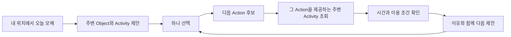

# 오늘 모해의 행동 중심 데이터 구조

2026년 10월 11일 · 개념 설계 0.2

**사용자 최신 범위 메모(2026-10-11)**: 제품의 목적은 내 위치에서 “오늘 모해?”로 시작해 다음 행동을 제안하는 것이지만, 현재 단계는 객체 데이터 구조와 수집·이관 계획을 먼저 정리하는 것이다. 아래 액션 연결·전환 규칙·선택 흐름은 후속 설계 방향이며 지금 구현할 범위가 아니다. 최신 정리와 다음 산출물은 [객체 데이터 구조와 수집 계획 상세보고서](</Users/dyl/reports/오늘모해 객체 데이터 구조와 수집 계획.md>)를 참조한다. 이 문서는 보조 개념 초안으로 유지한다.

첫 목적은 내 위치에서 “오늘 모해?”라는 생각을 구체적인 선택으로 바꾸고, 그 선택에서 다음 행동을 제안하는 것이다. 공연·장소·식사·볼거리를 공통된 활동 대상으로 보고, 먹고·마시고·쉬고·자고·즐기는 액션으로 연결한다. 누구·언제·무엇을·어떻게·왜의 전체 맥락을 미리 구축하지 않는다. 현재 위치와 오늘이라는 최소 맥락에서 시작한다.

## 서비스가 먼저 해야 할 일

첫 화면은 주변 대상 중 “여기서 무엇을 할 수 있는지”를 제안한다. 사용자가 하나를 선택하면 그 선택에서 이어갈 만한 행동과 대상을 제안한다. 예를 들어 “주변 볼거리 → 꽃축제 즐기기 → 가까운 곳에서 먹기 → 카페에서 마시거나 쉬기”다. 이것은 설명용 흐름이며 특정 장소의 현재 이용 가능성을 확인한 추천은 아니다.

한 번에 완성된 하루 계획을 만드는 것보다 한 선택이 다음 선택으로 이어지는 것이 우선이다. 제안은 사용자가 선택·건너뛰기·변경할 수 있으며, 아직 결정하지 않은 뒷부분을 강제하지 않는다. 시간·예약·이동 조건은 가능한 제안을 걸러내고 불확실성을 설명하는 데 사용한다.

## 공통 객체와 액션

공연·장소·식사를 같은 최상위 객체 Object로 다루되, 각 객체의 실제 의미는 보존한다. Object는 사용자에게 보여 줄 활동 대상의 공통 신원이다. 이름, 설명, 대상 종류, 위치 연결과 출처를 가진다.

| 개념 | 답하는 질문 | 예시 |
| --- | --- | --- |
| Object 활동 대상 | 무엇을 선택할까 | 호수공원, 꽃축제, 카페 지점, 식당, 실제 식사 상품 |
| Action 액션 | 거기서 무엇을 할까 | 먹기, 마시기, 쉬기, 자기, 즐기기 |
| Activity 활동 | 어떤 대상에서 어떤 행동을 할까 | 카페 A에서 마시기, 같은 카페에서 쉬기 |
| TransitionRule 다음 행동 규칙 | 다음에는 어떤 행동을 제안할까 | 즐기기 다음에 먹기, 먹기 다음에 마시기 |
| Suggestion 제안 결과 | 지금 어떤 대상과 행동을 보여 줄까 | 현재 선택 지점 근처의 식당 B에서 먹기 |
| SessionStep 선택 흐름 | 사용자가 무엇을 선택했나 | 축제 즐기기 → 식당에서 먹기 |

**핵심 연결 단위는 Activity = Object × Action이다.** 카페라는 객체에 마시기와 쉬기를 각각 연결할 수 있다. 한 액션은 여러 종류의 객체에 연결될 수 있고, 한 객체는 여러 액션을 제공할 수 있다. ‘관람하기·산책하기’ 같은 세부 액션은 실제 데이터와 UI에 필요해질 때 추가하고, 넓은 ‘즐기기’와의 관계를 정의한다.

액션 자체는 ‘먹기’라는 뜻을 정의하고, Activity는 ‘이 대상에서 먹을 수 있다’는 연결을 나타낸다. 액션 태그가 붙었다고 현재 방문 가능하다는 뜻은 아니다. 연결의 근거와 제안 기준도 함께 관리한다.

### 같은 객체로 다루되 같은 실체로 합치지는 않는다

꽃축제와 호수공원은 서로 다른 Object다. 축제는 공원에서 열리고, 공원 자체에서는 별도의 활동을 할 수 있다. 식당과 그 식당의 실제 판매 식사 상품도 다르다. 식당만 알고 있다면 ‘식당에서 먹기’로 충분하며 존재하지 않는 메뉴나 식사 상품을 만들 필요가 없다.

공연의 특정 회차는 Event의 일정 상세다. 일단 공연 Object에 ‘즐기기’ Activity를 연결하고, 제안할 때 해당 회차를 선택한다. 여러 회차가 있다는 이유로 첫 화면에 같은 공연을 반복 표시하지 않는다. 회차별 차이는 선택 단계에서 보여 준다.

## 데이터베이스는 관계형 구조로 먼저 설계

제안은 **공통 객체 테이블 + 종류별 상세 테이블 + 액션 연결 테이블 + 다음 행동 규칙**이다. 관계형 DB에 개체와 연결을 명시적으로 저장하면 된다. 화면이 그래프여도 처음부터 그래프 전용 DB를 도입할 필요는 없다. 여기서는 논리 구조를 정하며 특정 제품 도입이나 서버 연결은 별도 구현 단계다.

| 테이블 | 저장하는 내용 | 핵심 관계 |
| --- | --- | --- |
| objects | 내부 고정 ID, kind, 표시명, 설명, 공개 상태 | 모든 활동 대상의 공통 부모 |
| place_details | 주소, 좌표, 좌표 정확도, 시설 포함 관계 | object_id → objects, parent_place_id → 장소 |
| event_details | 행사 전체 기간, 개최 상태 | object_id → objects |
| event_places | 행사와 장소의 연결, 개최/시설참조/집결 역할 | event_id → 행사, place_id → 장소 |
| occurrences | 공연 회차 또는 확인된 운영 구간 | event_id → 행사, 회차 장소·시간 |
| product_details | 실제 식사·입장권·숙박 상품이 있을 때의 상세 | object_id → objects, 제공 장소/행사 연결 |
| actions | 먹기·마시기·쉬기·자기·즐기기 등의 의미와 표시명 | 고정 action_id |
| activities | 대상과 액션의 연결, 설명, 연결 근거, 검토 상태 | object_id + action_id 기본 유일 |
| activity_conditions | 활동별 운영/입장/소요시간 조건의 참조 | activity_id, 필요 시 occurrence_id |
| transition_rules | 이전 액션 → 다음 액션, 적용 조건, 기본 가중치, 버전 | from_action_id, to_action_id |
| decision_sessions | 일시적인 탐색 세션, 오늘 날짜, 현재 선택 상태 | 로그인이나 사용자 프로필 불필요 |
| session_steps | 선택한 Activity와 회차, 순서, 선택/취소 상태 | session_id + position, activity_id |
| suggestion_runs | 어떤 입력·정책으로 제안했는지 | session_id, 기준 시각, 정책 버전 |
| suggestion_items | 제안된 Activity, 이유, 확인 조건, 점수 항목 | run_id, activity_id, 선택 회차 |

objects의 kind는 초기에는 place / event / product 정도의 실체 구분이다. 카페·식당·공원은 장소의 세부 분류이며 먹기·쉬기는 액션이다. ‘먹기’라는 Object와 ‘카페’라는 Action이 뒤섞이지 않도록 한다. 분류와 액션은 서로 다른 테이블에서 관리한다.

장소·행사·상품 상세의 외래키는 올바른 objects.kind를 가리켜야 한다. 행사 장소 관계는 두 대상의 타입을 검사한다. Action 연결은 다대다이지만 같은 연결을 중복 생성하지 않는다. 회차별 조건 차이는 Activity를 복제하기보다 조건 테이블로 분리한다.

구조화해서 조회하는 값은 열과 관계로 저장한다. 공급자의 다양한 원문과 실험적인 점수 설명은 JSON 형태로 보조 저장할 수 있다. 이름·태그·원문을 모두 한 JSON에 넣고 매번 해석하는 방식은 핵심 구조로 삼지 않는다.

### 제안에 필요한 근거 데이터

출처·일정·입장 조건은 활동 연결을 지탱하는 하위 데이터다. 기존 상세 설계의 SourceSnapshot, Assertion, OpeningSchedule, Admission, Media를 연결해 사용한다. 초기 구현에서도 ‘미확인’과 ‘확인된 불가’, ‘무료’와 ‘요금 미확인’은 구별한다.

activities의 연결 근거에는 공급자 명시, 직접 검토, 편집 제안 여부를 둔다. ‘쉬기’는 편집 제안일 수 있지만 좌석·체류 허용·이용료까지 확인됐다는 뜻은 아니다. ‘자기’는 숙박이 확인되는 대상에 연결해야 하며 카페나 공원의 종류만으로 부여하지 않는다.

대상별 좌표를 공통 objects에 모두 복사하지 않는다. 행사는 event_places를 통해 실제 장소를 참조하고, 상품도 이용 장소를 참조한다. 가까움을 계산할 때는 이 장소 연결을 사용한다. 시설 대표점·정확한 입구의 차이도 유지한다.

## 액션은 어떻게 다음 대상으로 이어지는가

DB에 모든 장소 쌍의 연결을 미리 저장하지 않는다. “이 카페 다음은 반드시 이 식당” 같은 고정 연결 대신 **행동 전환 규칙으로 다음 액션을 고르고, 현재 맥락에서 해당 액션을 제공하는 대상을 찾는다.**

초기 전환 예시는 즐기기 → 먹기/쉬기, 먹기 → 마시기/즐기기, 마시기 → 즐기기/쉬기다. 이는 확정된 생활 법칙이 아니라 수정 가능한 편집 규칙이다. 액션의 순환은 허용한다. 다만 같은 대상을 반복 제안하지 않도록 세션의 선택·건너뛰기를 반영한다. ‘자기’도 액션 사전에 두되 숙박 대상과 상황이 확보되기 전에는 기본 다음 제안에 자동 삽입하지 않는다.

첫 제안에는 이전 액션이 없으므로 별도 시작 규칙을 사용한다. 현재 위치 근처에서 제공할 수 있는 서로 다른 액션의 후보를 보여 주고, 어느 액션부터 시작할지는 사용자 선택을 따른다. 위치를 제공하지 않으면 사용자가 고른 출발 장소를 기준으로 한다.

후속 제안의 거리 기준은 사용자가 선택한 마지막 활동의 장소다. 아직 그 장소로 이동한 실제 위치라고 기록하지는 않는다. 실제 출발점과 계획상 다음 출발점을 구별한다. 현재 시각, 계획상 활동 종료 시각, 사용자가 입력한 체류시간도 구별한다.

초기 점수에는 가까움, 액션 전환 적합도, 정보 충실도, 후보 다양성을 사용할 수 있다. 근거 없는 인기도는 넣지 않는다. 가중치 숫자는 소량 사례로 검증한 후 정한다. 후보가 부족할 때는 알려진 범위에서 선택을 제안하고, 미확인 장소를 확정 가능 대상으로 승격하지 않는다.

실제 경로 시간이 없거나 활동 종료가 미확인이어도 “이후 가볼 만한 주변 식당”이라는 탐색 제안은 가능하다. 다만 “18시에 도착 가능”이라는 시간 확정 제안과 분리해 표시한다. 다음 행동을 떠올리게 하는 기능이 모든 운영 정보의 완벽한 확보를 기다릴 필요는 없다.

## 한 흐름을 저장하는 예시

아래 ID와 연결은 개념 설명용이며 실제 데이터 입력이 아니다.

| 저장 위치 | 예시 |
| --- | --- |
| objects | O1 꽃축제(event), O2 공원(place), O3 식당(place), O4 카페(place) |
| event_places | O1은 O2에서 개최 |
| actions | A1 즐기기, A2 먹기, A3 마시기, A4 쉬기 |
| activities | V1=O1+A1, V2=O3+A2, V3=O4+A3, V4=O4+A4 |
| transition_rules | A1→A2, A2→A3, A2→A4 |
| session_steps | 첫 선택 V1, 다음 선택 V2 |
| suggestion_items | V3 또는 V4 제안, 가까움·행동 전환 이유와 운영 미확인 조건 |

V3과 V4는 같은 카페를 서로 다른 방식으로 제안하는 활동이다. 화면에서는 카페 카드 하나에 “마시기·쉬기”를 함께 보여 줄 수 있다. 이후 순서는 선택 로그에 저장하며, 제안된 항목과 실제로 선택한 항목을 혼동하지 않는다. 방문 완료도 선택만으로 추정하지 않는다.

## 기존 오늘모해 자료를 옮기는 방향

- 상설 장소 카탈로그와 시설 registry → objects + place_details. 같은 건물의 매장은 독립 대상이며 시설 포함 관계로 연결한다.
- 기존 행사 → objects + event_details + event_places + occurrences. 시설과 행사 객체를 분리하고 실제 회차를 보존한다.
- 기존 taxonomy → 대상 종류/주제 분류. 액션으로 그대로 이름만 바꾸지 않는다.
- 객체별 소량 검토 → activities. 카페/식당 유형은 액션 연결의 검토 후보를 만드는 데 사용하고, 운영 가능성까지 자동 확정하지 않는다.
- 기존 추천 점수 → 시작 후보와 다음 후보를 고르는 계산 요소. transition_rules를 새로 추가한다.
- 기존 하루 코스 → session_steps로 점진적 선택을 표현하고, 필요한 경우 그 결과를 상세 Itinerary로 확장한다.

언어·공급자와 무관한 고정 내부 ID와 기존 ID의 대응을 유지한다. SourceSnapshot·Assertion과 이관 안전 규칙은 [온톨로지 상세 설계](ontology-design.md)를 참고한다. 그 문서는 데이터 신뢰성과 시간 판단을 위한 보조 설계이며, 서비스 목적과 최상위 구조는 이 행동 중심 문서를 우선한다.

## 첫 단계의 범위와 완료 기준

첫 구현은 공통 객체, 액션 사전, Activity 연결, 다음 행동 규칙, 순서 있는 선택 상태와 제안 이유까지다. 장기 사용자 성향, 사회적 관계, 행동 동기의 전체 모델은 후속 범위다. 현재 위치는 기본적으로 세션 메모리에서만 사용하며 제안 로그에 정확한 GPS를 자동 보존하지 않는다. 서버의 세션/제안 영속 저장은 재현 필요성과 보존 기간을 정한 뒤 도입할 수 있다.

대량 수집 전에 소수의 장소와 행사로 다음을 확인한다.

1. 같은 카페에 마시기와 쉬기를 연결할 수 있다.
2. 축제를 선택하면 먹기 액션을 거쳐 주변 식당 후보로 넘어간다.
3. 같은 장소의 다른 행사, 같은 공연의 다른 회차를 구별한다.
4. 운영 미확인이어도 탐색 제안임을 설명하며 방문 가능으로 확정하지 않는다.
5. 사용자가 건너뛰거나 이전 선택을 바꾸면 다음 제안이 다시 계산된다.
6. 왜 해당 행동과 대상을 제안했는지 데이터에서 설명할 수 있다.

다음 산출물은 이 개념에 맞춘 테이블별 필드·키·관계 명세와 소량 예시 데이터다. 그 구조로 ‘오늘 모해 → 선택 → 다음 행동 제안’이 성립하는지 검증한 뒤 수집 범위를 넓힌다.
