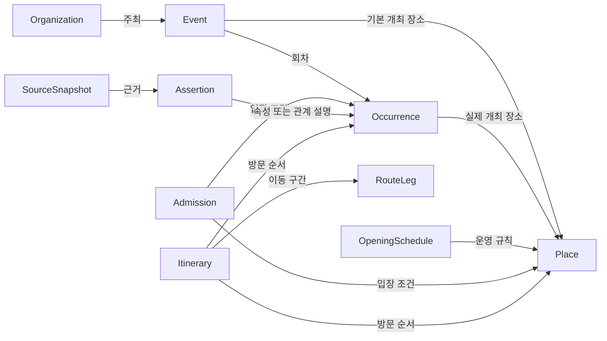

# 오늘모해 온톨로지 데이터 설계 초안

2026년 10월 11일 · 설계 버전 0.1 · 데이터 신뢰성 보조 설계

최신 사용자 방향은 [오늘 모해의 행동 중심 데이터 구조](ontology-concept.md)를 우선한다. 첫 목적은 내 위치에서 활동 대상을 선택하고 다음 액션으로 이어가는 제안이다. 이 문서의 폭넓은 사용자 질문과 시간·출처 모델은 이를 뒷받침하는 후속 상세 설계이며, 첫 구현의 전체 범위를 뜻하지 않는다.

오늘모해는 “누가, 어디서, 언제 출발해, 어떤 조건으로 무엇을 할 수 있는가”에 답한다. 장소와 행사를 수집하는 것만으로는 이 질문에 답할 수 없다. 실제 방문 대상, 운영 일정, 입장 조건, 이동 근거를 구별하고, 모르는 조건을 그대로 드러내는 모델이 필요하다.

이 초안은 AGENTS.md와 HANDOFF.md 최신 시작점을 따른다. 현재 저장된 데이터와 코드를 대상으로 설계했으며 아래 사례는 실시간 운영 확인이 아니다. 10대 분류·60세부분류, 데이터베이스 제품, API 이용권한은 확정하지 않는다. 첫 구현은 저장 기술에 독립적인 데이터 계약과 소량 변환 검증으로 시작한다.

## 먼저 답해야 하는 질문

| 사용자 질문 | 필요한 데이터 | 부족할 때의 답 |
| --- | --- | --- |
| 오늘 오후 아이와 갈 수 있나 | 방문일·연령 조건·동반 규칙·운영 회차·입장 조건 | 가족 주제 태그만으로 입장 가능이라 답하지 않음 |
| 지금 출발해 공연에 맞출 수 있나 | 출발 시각·교통수단·실제 경로 시간·입장 마감 | 직선거리만 있으면 도착 가능 미확인 |
| 비가 오는데 어디 갈까 | 시간·지역별 예보·방문 구역의 실내외·공식 취소 공지 | 야외 선호 점수는 조정하되 비만으로 취소 판정하지 않음 |
| 무료 축제인가 | 기본 입장과 별도 프로그램별 요금·자격 | 일부 무료를 전체 무료로 확대하지 않음 |
| 축제 후 카페까지 가능한가 | 행사 종료 또는 체류 계획·이동·카페 휴무/주문 마감·귀가 | 종료나 이동시간을 모르면 실행 가능한 코스로 확정하지 않음 |
| 이 사진과 정보는 믿을 만한가 | 촬영 대상·시점·사용권·필드별 출처·재확인 기한 | 장소 기록 사진과 현재 행사 사진을 구별 |
| 왜 이곳을 추천했나 | 통과 조건·미확인 조건·점수 항목·정책 버전 | 인기와 거리 기반 추천을 구별 |

방문 요청 VisitRequest에는 출발 좌표, 출발/귀가 시각, 시간대, 이동수단, 일행의 연령대·필요 조건, 예산, 관심사, 체류 선호를 둔다. 관심사와 필수 제약을 분리한다. 사용자 GPS와 일행 조건은 기본적으로 요청 수명 동안만 사용하고 공유 URL에 자동 포함하지 않는다.

## 개체와 관계

| 개체 | 의미와 주요 속성 | 다른 개체와의 연결 |
| --- | --- | --- |
| Place | 지속되는 물리적 장소. 공원·주제광장·공연장·카페 지점. 명칭, 주소, 지역, 좌표 정확도 | part_of → Place, operated_by → Organization |
| Event | 특정 개최 단위의 행사. 연도별 축제는 각각 다른 Event. 제목, 전체 기간, 개최 상태 | held_at → Place 0..N, organized_by → Organization 0..N, part_of → Event 0..1 |
| Occurrence | Event의 특정 회차 또는 확인된 운영 구간. 시작/종료, 시간대, 상태 | occurrence_of → Event 정확히 1, held_at → Place 0..N |
| Organization | 법인·브랜드·주최/운영 조직. 매장 지점과 구별 | 주최와 운영 역할을 별도 관계로 저장 |
| OpeningSchedule | 요일별 운영시간·예외일·휴무·휴게시간·적용 기간·완전성 | applies_to → Place 또는 Event 정확히 1 |
| Admission | 입장 방식·요금표·연령/동반 조건·예약 대상·마감·현재 잔여 여부 | applies_to → Place / Event / Occurrence 중 정확히 1 |
| Offer | 할인·혜택. 자격, 적용 시간, 금액/비율, 중복 적용 규칙 | applies_to → Place / Event / Occurrence / Product 1..N |
| Product | 특정 입장권·메뉴·체험 상품을 구별할 필요가 있을 때 도입 | sold_by → Organization, for_target → Place / Event / Occurrence |
| Media | 이미지·영상. 대상, 촬영일, 출처, 저작자, 허용 사용, 대체텍스트 | depicts → Place / Event / Occurrence 1..N |
| Source | 제공 기관·문서/API 항목의 출처 식별자 | has_snapshot → SourceSnapshot 0..N |
| SourceSnapshot | 특정 수집의 허용된 원문/필드, 해시, 수집 시각, 원문 갱신 시각, 저장 권한 | snapshot_of → Source 정확히 1 |
| Assertion | 한 속성 또는 관계에 대한 주장과 근거, 적용 시간, 검증 상태 | subject → 개체, predicate → 등록된 속성/관계, evidence → SourceSnapshot |
| Concept | 내부 표준 종류·주제. 의미ID, 다국어 라벨, 정의, 포함/제외 기준 | broader → 같은 차원의 Concept, classified_as 연결의 대상 |
| RouteLeg | 특정 출발 시각·수단·양 끝점에 대한 이동 결과. 공급자, 조회 시각, 유효 기한 | from/to → 방문 지점 또는 요청 출발점 |
| Itinerary | 순서 있는 방문 계획. 요청·정책 버전·판정 시각·귀가 조건 | stops → Place 또는 Occurrence, legs → RouteLeg |

장소가 알려지지 않은 행사도 연구 자료로 보존한다. 다만 장소가 없거나 여러 후보로 충돌하면 단일 방문 추천 대상이 아니다. 회차 장소가 행사 기본 장소와 다를 수 있으므로 회차의 명시 장소를 우선하고, 상속은 근거 있는 기본 장소일 때만 한다. 장소 part_of와 행사 part_of는 서로 다른 관계이며 순환을 금지한다.

관계 자체도 Assertion으로 근거를 갖는다. Organization을 이름만 보고 생성하거나 주최자로 추정하지 않는다. 상설 카페에는 가짜 Event를 만들지 않는다. Place의 운영 구간과 방문 요청을 결합해 조회용 방문 후보를 만든다. Product와 Offer는 초기 데이터에 필요하지 않으면 빈 영역으로 둔다.

이 선은 의미 관계다. 지도상의 근접, 그래프의 연결, 같은 시설 소속은 도로 연결이나 이동 가능성을 뜻하지 않는다.

## 종류와 조건과 평가를 분리

- 종류와 주제: 카페, 공연, 꽃축제처럼 “무엇인가”. 복수 분류를 허용한다. 종류·주제·지역은 별도 차원이며 내부 분류는 버전 관리한다.
- 방문 조건: 실내외, 휠체어 접근, 나이 제한, 반려동물 동반, 예약 필요, 무료 입장. 근거가 있는 속성 또는 Admission으로 기록한다.
- 평가: 인기·맛집·추천·가족에게 적합함. 측정 제공자, 기간, 표본, 계산 방법과 정책 버전을 갖는 파생 결과다. 주제 태그가 입장 허가를 뜻하지 않는다.

ProviderClassification에는 공급자, 원본 코드, 원본 분류 버전을 보존한다. ClassificationMapping은 내부 Concept, exact/broader/narrower/related 매핑 종류, 근거, 검토자, 버전을 갖는다. 불명확한 매핑은 미분류로 남긴다. UI의 “모먹어/모봐/모하고놀아”는 개체 종류·주제·조건을 조합하는 버전 있는 조회 규칙으로 둔다.

공연이라는 category에서 정시 입장 규칙을 도출하지 않는다. 방문 시간 방식 `fixed_start` / `entry_window` / `unknown`과 입장 마감·지각 입장 규칙을 별도로 둔다. 자유 입장 공연과 회차제 전시도 표현할 수 있어야 한다.

## 안정적 식별자와 원본 보존

내부 신규 ID는 한 번 발급한 UUID를 계속 사용한다. 번역명, 주소 문자열, 좌표, 회차 시작 시각을 ID로 삼지 않는다. 이름 변경·이전·공연 시간 변경 후에도 동일성 검토 결과에 따라 기존 ID를 유지한다. 기존 ID는 버리지 않고 alias로 보존한다.

ExternalIdentity는 `provider + entity_type + provider_id + edition_key`와 내부 ID의 대응이다. 공급자가 매년 같은 행사 ID를 재사용하면 개최 단위를 구별한다. 장소의 브랜드와 지점은 분리하고 동일 주소의 다른 층·입점 매장을 자동 병합하지 않는다.

원본, 정규화된 주장, 채택된 현재 값, UI 조회 결과를 분리한다. 정규화 시 `source_snapshot_id`, 원본 필드 경로, `transform_version`, 변환 시각을 남긴다. 원문 전체를 저장할 권한이 없으면 허용된 필드·인용 범위·해시·출처만 저장한다. 비밀키와 인증 쿼리는 저장·공개하지 않는다.

## 필드별 사실 계약

Assertion의 최소 계약은 다음과 같다. 아래는 데이터 계약 설명이며 실행 스키마는 다음 단계에서 작성한다.

| 필드 | 의미와 제약 |
| --- | --- |
| id, subject_id, predicate | 주장 ID, 대상, 허용된 속성/관계. predicate마다 값 타입과 대상 타입 등록 |
| knowledge_state | known / unknown / not_applicable / conflict. 필드 부재는 known으로 해석하지 않음 |
| value | known일 때 타입에 맞는 값 필수. `false`는 확인된 거짓, `0`은 확인된 0원. unknown과 구별 |
| evidence_refs | snapshot ID, 원문 필드/구간, 확인 방법. known과 not_applicable은 근거 필수 |
| valid_from, valid_until | 사실이 적용되는 시간. 종료 미상은 미상이며 영구 유효 보장이 아님 |
| recorded_at, checked_at, recheck_after | 시스템 기록 시각, 실제 확인 시각, 다음 확인 기한. 수집 시각을 확인 시각으로 승격하지 않음 |
| method | provider_report / direct_review / derived / editorial / legacy_import |
| review_state | unreviewed / reviewed / rejected. 검토됨과 현재 신선함은 별개 |
| supersedes, derived_from | 정정 대상과 계산에 사용한 주장 ID 목록 |
| conflict_refs, resolution | 충돌 주장, 선택/보류 이유, 해결자, 해결 시각 |

값의 진위와 자료 상태는 다른 축이다. `known:false`는 “반려동물 불가 확인”, `unknown`은 “미확인”, `not_applicable`은 “적용 대상 아님”, `conflict`는 서로 양립하지 않는 주장이다. 오래된 값은 원래 주장을 유지하고 조회 시 freshness=stale로 처리한다.

충돌 판단은 같은 대상·속성·적용 구간·조건에서 한다. 성인/아동 가격이나 날짜별 운영시간은 서로 다른 조건일 수 있다. 공식 출처라도 새 수집이라는 이유만으로 기존 값을 덮어쓰지 않는다. 원문 갱신 시각, 직접 공지 여부, 적용 범위를 검토해 해결 기록을 남긴다. 예약·운영 상태처럼 중요한 충돌은 해결 전 자동 추천을 차단한다.

원문 날짜와 번역 텍스트도 버전을 연결한다. 번역은 별도의 사실 근거가 아니며 원문 변경 시 재검토 상태가 된다.

## 시간과 방문 가능성

행사 전체 기간은 날짜 범위이며 마지막 날짜를 포함한다. 실제 운영 구간과 회차는 시간대가 있는 `[start, end)`로 계산한다. 예를 들어 18시 종료는 18시에 새로 입장할 수 있다는 뜻이 아니다. 시작만 알려진 회차는 끝을 null로 보존하고 예상 60분을 공식 종료로 채우지 않는다.

OpeningSchedule에는 적용 날짜, 요일, 하루의 복수 운영 구간, 휴게시간, 예외일, 명시 휴무, 시간대와 `coverage=complete/partial/unknown`을 둔다. complete인 적용 범위에서만 없는 회차를 휴무로 판단한다. partial 목록에 없는 시간은 미확인이다. 자정 넘는 운영은 다음 날짜 종료 시각으로 표현한다.

예외·취소 → 회차의 명시 조건 → 근거 있는 기본 규칙 순으로 적용한다. 동일 우선순위 충돌은 임의 선택하지 않는다. 공원 개방시간을 축제 시간으로, 건물 운영시간을 입점 매장 영업시간으로 상속하지 않는다. 기간뿐인 행사에서 일일 Occurrence를 생성하지 않는다. 근거 있는 반복 규칙을 펼칠 때만 파생 회차와 원래 규칙 버전을 연결한다.

Admission에는 예약 필요 여부와 예약 재고를 별도로 둔다. 참가자 모집·공연자 모집·관람객 입장을 구별한다. 예매 링크가 있다는 사실로 잔여석을 추정하지 않는다. 가격은 통화·대상·티켓 종류·적용 기간·포함 항목을 갖는 요금 행으로 보존한다. 기본 입장과 유료 부대행사, 유료 메뉴는 각각 다른 범위다.

VisitAssessment는 요청별 계산 결과다. `as_of`, `policy_version`, 대상 ID, 사용한 Assertion ID, `valid_until`, 이유 코드를 반드시 반환한다. valid_until은 사용 근거와 경로의 기한 및 다음 운영 경계 중 가장 이른 값이다.

| 판단 축 | 값 | 예시 이유 코드 |
| --- | --- | --- |
| 운영 시간 | eligible / ineligible / unknown / conflict | ended, no_confirmed_window, hours_conflict |
| 입장 자격과 예약 | eligible / ineligible / unknown / conflict | age_restricted, sold_out, booking_unknown |
| 이동과 시간 여유 | fits / does_not_fit / unknown | route_unknown, missed_entry, return_unknown |
| 근거 신선도 | fresh / stale / unreviewed | stale_hours, stale_admission |
| 표시 결과 | excluded / needs_check / candidate / plan_fits | 위 판단 근거의 조합 |

취소·종료·휴무·자격 불일치 등 유효한 근거의 확정 불가 조건이 있으면 excluded다. 필요한 정보가 미확인·충돌·만료이면 needs_check다. 당일 운영·입장 조건에 필요한 근거가 모두 유효하면 candidate, 경로·체류·귀가까지 맞으면 plan_fits다. candidate는 도착 가능 판정이 아니고 plan_fits도 좌석 확보나 현장 입장을 보장하지 않는다.

탐색 목록에는 needs_check를 표시할 수 있다. 초기 자동 코스는 현재처럼 유효한 근거를 갖춘 현장 입장 대상부터 허용한다. 예약 필수 대상은 사용자 표 확보 여부와 해당 회차 조건을 확인할 수 있을 때 확장한다. 시설 대표점만으로 계산한 경로에는 접근 구간 미확인을 남겨 정확한 입장 마감 충족을 단정하지 않는다.

사용자가 정한 체류시간은 user_estimate로 표시하고 공식 소요시간과 분리한다. 날씨는 지역·예보 대상 시각·발표/조회 시각·제공자를 갖는 판단 입력이다. 단순 강수 예보는 선호 점수에 사용하고 공식 취소는 별도 운영 주장으로 반영한다. 추천 점수는 자격 판단 이후 계산하며 이유와 점수 항목을 노출한다.

## 기존 자료로 검증하는 세 사례

### 호수공원 축제

기존 `public/data.json`의 `mohae-goyang-e6da1b391beb5c1c`는 2026 고양 가을꽃 축제이며 10월 1일부터 11일까지, 각 날짜 09시부터 18시까지의 세션을 담고 있다. 기존 확인 기한은 10월 10일로 이미 지났다. 이 일정은 저장 자료를 설명하며 현재 운영을 재확인한 값이 아니다.

- Event는 축제, Place는 일산호수공원과 개최 구역인 주제광장을 구별한다. 주제광장과 공원의 포함 관계도 근거를 연결한다.
- `place-8473926541ae`는 공원 시설 기준점이다. 주제광장의 정확한 좌표나 입구로 승격하지 않는다. 지도는 “시설 기준점”으로 표현할 수 있다.
- 기존 11개 세션은 원래 근거/변환 계보를 확인한 뒤 Occurrence로 이관한다. 이관 사실 자체가 새 검증은 아니다.
- 야외 축제 기본 입장 무료와 `mohae-goyang-b957dc9f49a31d09` 토크콘서트의 유료 입장을 분리한다. 프로그램 관계를 검토할 수 있지만 요금이나 예약 조건을 상속하지 않는다.
- 기존 `admission=walk_in`과 `unknown_fields`의 reservation이 함께 있다. field별 근거 대조 전 현장 입장을 확인된 값으로 승격하지 않는다.
- 10월 11일 18시 이후 운영 구간은 종료되어 후보에서 제외한다. 그 전이어도 현재 자료의 만료 상태 때문에 자동 추천은 보류한다.

### 상설 카페

`public/place-catalog.js`의 `forest-outings-ilsan`은 포레스트 아웃팅스 일산의 명칭·주소·공식 안내 링크와 확인 날짜를 갖는다. hours와 point는 null이다.

- 지점 Place 한 개로 이관하고 기존 ID는 alias로 유지한다. 별도 행사를 생성하지 않는다.
- 주소와 링크는 기존 조사 수준을 유지한다. 날짜만 있는 checked를 임의의 정확한 확인 시각으로 바꾸지 않는다.
- 좌표·영업시간·휴무·주문 마감·대기 여부는 unknown이다. 지도점과 지금 영업 중 표시는 만들지 않는다.
- 카페/베이커리 종류는 기존 편집 분류의 근거·버전을 보존한다. 유명함·인기·아이 동반 허용을 추가하지 않는다.
- 같은 방식으로 스타필드 본관과 B1 갓덴스시, 3층 광화문미진을 별도 Place로 둔다. 주소가 같아도 합치지 않고 매장 운영시간도 본관에서 가져오지 않는다.

### 공연 회차

`goyang-artgy-8473` 리베란테 공연은 저장 자료에 2026년 12월 25일 17시 시작이 있고 종료 시각은 없다. 장소 표시명은 아람극장이지만 연결된 좌표는 고양아람누리 시설 기준점이다.

- Event와 17시 Occurrence를 나누고 아람극장과 고양아람누리의 장소 구분을 검토한다. 기존 시설 좌표를 극장 입구로 복제하지 않는다.
- 회차 end=unknown, 입장 마감·지각 입장·잔여석도 unknown이다. category=performance만으로 새로운 확정 입장 규칙을 만들지 않는다.
- R/S/A/B 요금 원문은 보존한다. 좌석 등급별 금액을 파싱한다면 변환 규칙과 원문 근거를 연결하고 재고로 해석하지 않는다.
- 설계 테스트에서 17시 정시 입장 조건을 별도 가정으로 부여했을 때 17시 5분 도착은 제외해야 한다. 이는 실제 공연의 지각 입장 정책을 확인했다는 뜻이 아니다.
- 16시 30분 도착을 가정해도 종료·예약·접근 구간이 미확인이므로 공연 후 저녁 코스를 plan_fits로 만들지 않는다.

## 기존 데이터의 이관 표

| 현재 입력 | 새 모델 | 주의점 |
| --- | --- | --- |
| public/data.json events, source_version | Event, SourceSnapshot 연결 | 로컬 기준 232건. 배포 시 API 병합본과 스냅샷을 별도 입력으로 고정 |
| schedule 기간, sessions, exceptions | Event 기간, Occurrence, OpeningSchedule 예외 | complete_sessions와 partial을 보존, 종료 null 유지 |
| editorial.recurrence | OpeningSchedule와 파생 Occurrence | 규칙 근거·적용 범위·예외를 보존 |
| venues, places, venue-registry, event-place-bindings | Place와 held_at, 표시용 시설 참조 관계 | venue ID와 시설 ID의 동일성 자동 가정 금지 |
| place-catalog.js | 상설 Place, 초기 분류 주장 | null과 날짜 정밀도를 보존 |
| price, reservation, verification.admission | Admission과 요금 행 | 원문 범위와 필드별 근거 일치 검토 |
| verification, evidence | Assertion과 검토 기록 | 레코드 전체의 reviewed를 모든 필드의 확정으로 복사하지 않음 |
| taxonomy.js, classifications.json | Concept, ClassificationMapping, 분류 Assertion | 잠정 UI 분류, 기존 버전·원문 해시 보존 |
| data/media.json, editorial.media | Media, depicts, 사용권 기록 | 시설 사진을 행사 사진으로 연결하지 않음 |
| tourapi-snapshot, lib/tourapi-normalize.mjs | SourceSnapshot, ExternalIdentity, 정규화 주장 | 원본 분류와 내부 분류 분리, API 운영 회차 추정 금지 |
| discovery.js, recommendations.js, visit-policy.js | VisitAssessment와 별도 점수 계산 | 점수/분류를 사실이나 입장 규칙으로 사용하지 않음 |
| engine.js planDay, 사용자 방문 목록 | Itinerary, RouteLeg | 이동 미확인과 사용자 체류 가정을 보존 |

현재 TourAPI 정규화는 이름·지역·날짜로 중복 후보를 찾고 장소도 이름·좌표 근접으로 공유한다. 앞으로 이 결과는 자동 동일성 확정이 아니라 병합 제안으로 둔다. 검토된 기존 매핑 역시 근거와 버전을 남긴다. 병합은 alias와 판단 기록을 남기고, 잘못된 병합의 분리 시 주장별 원래 대상을 복구한다. 다른 개최 연도·같은 이름의 다른 지점·같은 건물의 다른 홀은 별개다.

## 수집 전 검증과 운영 규칙

필수 구조 검사는 중복 ID, 끊긴 참조, 관계 대상 타입, 포함 순환, 날짜 역전, 시간대 누락, 좌표 범위, 음수 요금, 근거 없는 known, 정책/변환 버전 누락을 차단한다. 같은 장소의 겹친 운영 구간은 휴게시간·범위 차이를 대조하고, 확정할 수 없는 충돌은 검토 대기열로 보낸다.

| 회귀 시나리오 | 기대 결과 |
| --- | --- |
| 행사 기간만 있고 당일 회차 없음 | needs_check, 회차 자동 생성 없음 |
| complete 회차 범위 안에 선택일 회차 없음 | excluded |
| partial 회차 목록에 선택일 회차 없음 | unknown 유지 |
| 18시 종료 구간에서 18시 신규 방문 | excluded |
| 자정 넘어 종료하는 회차 | 현지 날짜와 절대 시각으로 정상 계산 |
| 영업 규칙과 임시 휴무가 함께 있음 | 유효한 명시 휴무 적용 |
| 같은 구간의 공식 운영 정보 충돌 | needs_check, 자동 코스 제외 |
| 예약 false / unknown / not_applicable | 세 값을 구별하고 근거 검사 |
| 무료 축제 안 유료 프로그램 | 프로그램에 무료 상속 없음 |
| 공연 시작만 있고 종료 없음 | 후속 코스 plan_fits 금지 |
| 당일 운영 확인, 이동은 직선거리만 있음 | 이동 unknown, 도착 시각 생성 없음 |
| 이름 변경 또는 회차 시각 변경 | 동일성 확인 후 ID 유지 |
| 같은 주소의 다른 층 두 매장 | 자동 병합 금지 |
| 유효한 행사에 만료된 입장 근거 | needs_check |
| 위치 근거만 새로 확인 | 운영/예약의 확인 기한 갱신 없음 |
| 사진 권리 또는 촬영 대상 미확인 | 이미지 공개 제외, 대체 그래픽 |

종료 행사는 이력으로 보존하고 현재 방문 후보에서 제외한다. 수집 목록에서 사라진 자료는 바로 삭제·취소로 판정하지 않고 missing 상태로 재확인한다. 삭제 요청이나 사용권 철회는 공개 자료와 캐시에서 제거하고 재도입 방지 tombstone을 남긴다. 보존 가능한 최소 감사 기록의 범위도 권한에 맞춘다. 원문·미디어 보관 기한은 공급자별로 정하며 무기한 저장을 기본값으로 두지 않는다.

재확인 기한은 운영시간·예약·사진 권리 등 predicate별 정책으로 둔다. 초기에는 기존 기한을 늘리지 않는다. 예약 재고는 실시간 연동 전 unknown으로 유지한다. 만료 자료는 재수집 큐로 보내고 실패 시 기존 값을 새 확인값처럼 갱신하지 않는다.

## API 수집 전략과 구현 순서

1. 이 초안의 개체·시간·주장·조회 계약으로 실행 가능한 스키마와 위 회귀 fixture를 만든다. 데이터베이스 선택은 이 단계의 선행 조건이 아니다.
2. 위 세 사례와 부대 토크콘서트만 격리된 입력으로 변환한다. 스키마 검사, 원본 추적, 미확인/만료 상태 보존을 통과시킨다.
3. 전체 기존 로컬 자료와 보관된 API snapshot을 네트워크 없이 shadow 변환한다. old ID → new ID 대응, 병합/분리 후보, 충돌, 보류 이유, 누락 필드를 보고한다. 건수 감소는 개별 매핑으로 설명해야 한다.
4. 새 조회 모델에서 기존 UI용 호환 출력을 만든다. 지도와 그래프는 같은 VisitCandidate 조회를 소비하며 지도 공급자 ID는 어댑터에서만 쓴다. 과거 행사·좌표 없음·만료 자료가 추천으로 승격되지 않는지 기존 정책과 비교한다.
5. 공급자마다 수집 가능 필드, 저장/갱신/재배포/타 지도 표시/사진 이용 범위를 확인한 SourcePolicy를 만든다. 미검증 권한은 unknown이며 해당 저장·공개 단계를 차단한다. TourAPI부터 기존 연결 범위 내 소량 검증하고 카카오/Naver 보완은 권한 확인 후 판단한다.
6. 원본 입력 → 형식 검사 → 정규화 주장 → 동일성 검토 → 충돌/신선도 검토 → 공개 조회 생성 순으로 수집 파이프라인을 연결한다. 공급자 키+원본 버전+변환 버전으로 재실행 중복을 방지하고, 실패 항목은 격리한다. 부분 수집 실패가 기존 자료 삭제로 이어지지 않게 한다.
7. 대량 수집 전 회귀 통과, 필드별 근거 연결, 모든 보류 이유, 권한 정책, 공개 회귀 비교를 확인한다. 새 schema_version / taxonomy_version / policy_version과 스냅샷 전환 기록을 남기며 기존 출력으로 되돌릴 수 있어야 한다.

구현 기술은 이 계약을 검증한 뒤 정한다. 초기 JSON 파일로도 개체·관계·Assertion을 표현할 수 있고, 이후 관계형 DB로 옮겨도 의미 구조는 유지할 수 있다. 그래프 DB나 RDF 채택 여부는 실제 조회와 운영 요구를 보고 결정한다.

다음 구현 범위는 실행 스키마, 세 사례 fixture, 검증기, 소량 변환 보고서다. 대량 수집 확대는 그 결과를 확인한 뒤 진행한다.
